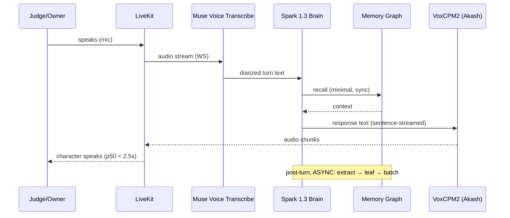
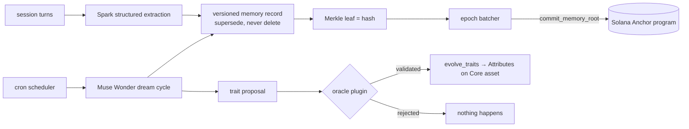
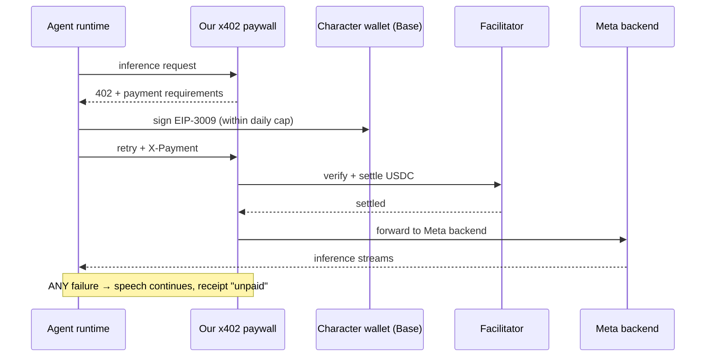

# SOULBOUND: Architecture & Requirements

**Status:** v1.0 · 2026-10-26 · awaiting final ratification
**Method:** bounded-payments doc discipline (canonical SVG + use-case table + design decisions + actors/signers + atomic REQs with tests) × system-design-skills five-step framework × Kun engineering gates × Jia Chen demo laws.
**Canonical diagram:** [architecture-overview.svg](architecture-overview.svg) (D1). Flow diagrams D2–D4 are Mermaid, below — GitHub renders them natively.

---

## 1. Overview

SOULBOUND is a persistent multimodal character whose relationship with its owner changes through interaction and leaves verifiable on-chain continuity. Judges interact with it live; every interaction can change it; every change is provable.

| Use case | Component / handler | Signer / actor | Pass condition |
| --- | --- | --- | --- |
| UC-1 Birth a character | `initialize_character` (Anchor) | Owner | One Metaplex Core asset + one Token-2022 soulbound receipt minted to owner; config PDA created; invalid input creates nothing. |
| UC-2 Live voice turn | agent worker (off-chain) | — | Spoken question → spoken answer in the character's locked voice; first audio p50 < 2.5s warm. Diarization failure degrades to stranger-greeting, never to silence. |
| UC-3 "Look at this" | agent runtime + SAM 3.1 | Owner / judge (explicit trigger) | One user-approved frame → mask → structured observation stored as a memory with provenance. No frame, no capture. |
| UC-4 Recall + verify | app backend | — | A recalled memory renders with a Merkle inclusion proof verifiable against the current on-chain root on a public explorer. |
| UC-5 Dream cycle | cron → Muse Wonder → runtime signer | Runtime signer (oracle-gated) | Between sessions: journal written, trait proposal produced, `evolve_traits` applies it on-chain. Non-oracle mutation is rejected. |
| UC-6 Self-payment | x402 paywall + character wallet (Base) | Character key (policy-limited) | Each inference call settles USDC via EIP-3009 and logs a receipt. Payment failure NEVER blocks speech; receipt marked `unpaid`. |
| UC-7 Heartbeat | `crank_heartbeat` (Anchor) | Anyone (permissionless) | Life stage advances when on-chain conditions hold; caller paid from vault PDA; early crank changes nothing. |

---

## 2. Non-functional targets

| Target | Value | Notes |
| --- | --- | --- |
| First-audio latency (voice turn) | p50 < 2.5s, p95 < 4s | Warm TTS. Speech-to-speech; chain ops never in this path (C01). |
| TTS cold start | eliminated | Akash GPU prewarmed before any judging session (C08). Three consecutive clean runs = readiness gate. |
| Root commit latency | < 60s after session end | Fully async; user never waits on Solana. |
| Demo availability | core loop survives: facilitator down, Akash down, Solana RPC down | Each has a named fallback (§9). |
| Privacy | zero raw audio/transcript/portrait bytes on-chain | Only hashes/roots/traits on-chain (C02). Raw media session-scoped. |
| Cost | < $1 per character-day at demo scale; hackathon total inside $150 Meta credit | Contributor-tier Spark NEVER touches personal memories (it trains on data). |
| Demo scale | ~100 sessions/day peak, ~10 turns each | Sizing only; viral path discussed in §8. |

## 3. Capacity estimation (back-of-envelope, before boxes)

| Quantity | Assumption | Math | Result |
| --- | --- | --- | --- |
| Tokens/day | 100 sessions × 10 turns × (1k in + 300 out) | 100×10×1.3k | ~1.3M tok/day → trivial vs $150 credit |
| TTS GPU-hours/day | 15s audio/turn, RTF ~0.13 (Nano-vLLM) | 1000 turns × 15s × 0.13 | ~0.5 GPU-hr → one 4090 idles |
| Solana tx/day | ~2 commits+traits per session | 200 tx | sub-cent total |
| Base x402 | ~$0.01–0.05 per session | faucet USDC | negligible |

Conclusion: no component needs scale engineering. Spend the complexity budget on **latency pipelining and failure behavior**, not throughput.

---

## 4. Design decisions

| ID | Decision |
| --- | --- |
| D1 | The **Metaplex Core asset IS the character** (canonical identity; Attributes plugin holds mutable trait state). The **Token-2022 non-transferable token is ONLY the ownership receipt**. One identity, one receipt; they never compete (Q09). |
| D2 | Raw memory content (text, embeddings, media) lives **off-chain**; only Merkle roots and trait state go on-chain. Any memory is inclusion-provable without revealing content (C02). |
| D3 | **Sync/async split:** voice turn + minimal recall = synchronous. Portraits, trait mutation, Merkle commits, dream cycle = asynchronous. Only labeled-precomputed content is precomputed (C01). |
| D4 | **x402 never gates speech.** Payment is supporting proof; failure → conversation continues, `unpaid` receipt (Q10, C05). Testnet wallet, hard daily cap, kill switch. |
| D5 | Vision is **on-demand "look at this" only** — one explicit frame per trigger, never continuous (Q11). |
| D6 | Diarization beat kept but **degrades gracefully**: ambiguous attribution → "new voice — nice to meet you." Single-speaker path is the guaranteed core (Q12, C06). |
| D7 | **Model purity:** every product inference is a Meta model. The x402 paywall fronts OUR Meta backend. surp-router is reference/citation only (Stage-1 pass/fail protection). |
| D8 | **Human-authored REQs are the intent source of truth** (this document). Muse Code implements against them; agent-written tests do NOT count as independent verification (Kun: an agent-written test is a second copy of the agent's interpretation). |
| D9 | **Author/reviewer isolation:** Muse Code (doer) implements; AdaL (thinker) adversarially reviews each diff against the REQ table before merge. Validation rigor matches stakes (Kun). |
| D10 | The dream cycle is a **deterministic cron scheduler invoking Wonder** — never an agent relying on its own context to remember to dream (Kun: deterministic harnesses for repeated loops). |
| D11 | The UI always shows **which model answered and what the turn cost**. Hidden model identity/cost = broken trust (Kun). |
| D12 | Memory records are **versioned; corrections supersede, never delete.** A deleted-looking memory breaks the audit story. |
| D13 | LiveKit transport; character voice is **Voice-Designed by Spark from the persona, rendered by VoxCPM2, seed locked Day 2** (VoxCPM2 output varies run-to-run per vendor docs). |
| D14 | Scope ledger (Q16) is binding: CCIP mirror, ERC-8004, continuous vision, complex oracle behavior, and payment-in-critical-path are **cut unless Days 1–7 finish early**. |
| D15 | TTS sits behind a **replaceable interface**; VoxCPM2-on-Akash is primary, a second provider is the documented fallback (C08). |

## 5. Actors and signers

| LOI category | Actor | Signs | Can | Cannot |
| --- | --- | --- | --- | --- |
| Direct actor | Owner | `initialize_character`, receipt holder | Birth the character. Talk to it. Trigger "look at this". Kill the wallet switch. | Mutate traits directly (oracle-gated), transfer the receipt. |
| Direct actor | Runtime signer (backend key) | `commit_memory_root`, `evolve_traits` | Commit roots; apply oracle-validated trait proposals. | Move owner assets; mint receipts; alter history (roots are append-only). |
| Direct actor | Character key (Base) | EIP-3009 authorizations | Pay the paywall within daily cap. | Exceed cap; transfer wallet balance outward; sign anything else. |
| Direct actor | Crank caller (anyone) | `crank_heartbeat` | Advance life stage when due; claim crank reward. | Forge roots or traits. |
| Beneficiary | Judge / visitor | nothing | Talk, show an object, verify a memory proof. | Write any state. |
| Administrator | Owner (devnet) | upgrade authority | Upgrade the program. | Rewrite committed roots (append-only account structure prevents it). |
| Stakeholder | Metaplex / Token-2022 / facilitator / Circle | n/a | Enforce their own program rules. | — |
| Trigger | Dream scheduler (cron) | n/a | Invoke the Wonder dream cycle. | Sign on-chain directly (its output is validated by the oracle plugin + runtime signer). |

**Trust boundary (explicit):** inside the boundary = Solana program state, Core asset + plugins, Token-2022 receipt, Base wallet policy. Outside = agent worker, all models, VoxCPM2, LiveKit, memory DB, paywall server. Everything outside is an **untrusted input**; the chain layer verifies signatures and roots only.

## 6. Data flows

**Write path (live turn):** audio → Muse Voice Transcribe (diarized turns) → Spark brain (tools: memory read/write, SAM observation ingest) → VoxCPM2 audio out. Post-turn (async): Spark structured extraction → versioned memory record → Merkle leaf → batch → `commit_memory_root`.

**Dream path (async):** cron → Wonder reads memory graph → journal + trait proposal → oracle-plugin validation → runtime signer → `evolve_traits` → Attributes update visible on explorer.

**Read path (verify):** app renders memory → computes inclusion proof against current epoch leaves → explorer link to the root commit tx → anyone re-derives the root off-chain and compares.

**Payment path:** agent runtime → paywall 402 → character key signs EIP-3009 → facilitator settles USDC on Base → inference streams → receipt logged and shown on the life page. Failure at any point: speech continues, receipt `unpaid`.

## 7. Flow diagrams (D2–D4)

### D2 — Live voice turn (synchronous path)

### D3 — Memory lineage + dream cycle (async)

### D4 — Self-payment (x402, Base)

## 8. Scaling & bottlenecks (named, per framework step 5)

| Load level | Bottleneck | Fix | Cost |
| --- | --- | --- | --- |
| Demo day | TTS cold start on Akash | prewarm + keepalive + replaceable TTS interface | one GPU idling |
| Demo day | serial STT→LLM→TTS latency | sentence-level streaming pipeline; TTS starts on first sentence | engineering time |
| Demo day | Solana public RPC rate limits | dedicated RPC (Helius free tier) | zero |
| Viral | per-character state growth | memory graph per character; roots batched across characters into one daily commit | storage |
| Viral | inference cost per user | character's own x402 wallet funds itself — the business model IS the scaling answer | — |
| Long-term | context staleness in big windows | structured memory graph over transcript stuffing (Kun: stale auto-memory is a liability) | — |

## 9. Validation protocol (Kun gates — binding)

1. **REQ tables below are human-authored intent.** Muse Code implements; it may not edit REQs. A failing REQ test means the *code* is wrong, by construction.
2. **E2E over unit:** the binding suite is a scripted **judge simulation** (play the 180s storyboard headlessly) run on every merge to `main`.
3. **Adversarial review per task:** AdaL reviews every Muse Code diff against the REQ table with author/reviewer isolation before merge. High-stakes surfaces (wallet policy, oracle gate, receipt mint) get the deepest review.
4. **Two-rehearsal rule (Q17):** every demo beat passes twice consecutively, on the record, before submission.
5. **Evidence honesty (bounded-payments rule):** no fabricated outputs. Every claim in the README maps to a reproducible artifact: tx link, log, or video timestamp. Unverified claims are labeled unverified.

## 10. Atomic requirements

### UC-1 `initialize_character` (signer: Owner)
| REQ | The program shall | Test |
| --- | --- | --- |
| REQ-01 | Create one character config PDA with seeds `["character", owner, character_id]` | Address derives from those seeds, canonical bump |
| REQ-02 | Mint exactly one Metaplex Core asset as the character identity | Asset exists, owner = owner wallet |
| REQ-03 | Attach the Attributes plugin with the genesis trait vector | Attributes readable on-chain |
| REQ-04 | Attach the Oracle plugin gating `evolve_traits` to the runtime signer | Non-oracle mutation rejected |
| REQ-05 | Mint exactly one Token-2022 non-transferable receipt to the owner | Transfer attempt fails |
| REQ-06 | Reject duplicate `character_id` for the same owner | Second init fails |
| REQ-07 | Set life stage to `born`, memory epoch to 0 | Read config |

### UC-2 `commit_memory_root` (signer: Runtime signer)
| REQ | The program shall | Test |
| --- | --- | --- |
| REQ-10 | Append `(epoch, root, timestamp)` to the character's root history account | History grows by one |
| REQ-11 | Reject a signer that is not the runtime signer | Forged signer fails |
| REQ-12 | Reject a duplicate or regressed epoch | Replay fails |
| REQ-13 | Emit an event carrying the root | Event parseable by the indexer |

### UC-3 `evolve_traits` (signer: Runtime signer, oracle-gated)
| REQ | The program shall | Test |
| --- | --- | --- |
| REQ-20 | Apply a validated trait delta to the Attributes plugin | Explorer shows new traits |
| REQ-21 | Reject any direct owner or third-party mutation | Both fail |
| REQ-22 | Record the dream-cycle journal hash that motivated the mutation | Hash stored, linkable to off-chain journal |

### UC-4 `crank_heartbeat` (permissionless)
| REQ | The program shall | Test |
| --- | --- | --- |
| REQ-30 | Advance life stage only when its on-chain precondition holds | Early crank fails |
| REQ-31 | Pay the crank caller from the vault PDA | Caller balance increases |
| REQ-32 | Change no state when the precondition fails | Account diffs empty |

### UC-5/6 Agent runtime (voice + vision)
| REQ | The system shall | Test |
| --- | --- | --- |
| REQ-40 | Deliver first audio p50 < 2.5s warm | Latency harness, 20-turn run |
| REQ-41 | Answer with the locked VoxCPM2 voice seed | Seed constant in config; two runs match timbre |
| REQ-42 | On diarization ambiguity, greet as stranger and continue | Injected ambiguity → stranger greeting |
| REQ-43 | Capture vision ONLY on explicit trigger | No frames leave without a trigger event |
| REQ-44 | Store every observation with provenance (frame hash, mask, timestamp) | Record fields present |

### UC-4 Memory + verification
| REQ | The system shall | Test |
| --- | --- | --- |
| REQ-50 | Version memory records; corrections supersede, never delete | Correction yields v2, v1 retained |
| REQ-51 | Produce a valid inclusion proof for any committed memory | Proof verifies against on-chain root |
| REQ-52 | Fail verification loudly for a tampered memory | Modified byte → proof fails |

### UC-6 Payment
| REQ | The system shall | Test |
| --- | --- | --- |
| REQ-60 | Never block or delay speech on payment state | Facilitator killed mid-demo → speech continues |
| REQ-61 | Enforce the daily spend cap on the character key | Cap+1 request refused |
| REQ-62 | Log every receipt (paid/unpaid) to the life page | Receipt list grows |

### Privacy + evidence
| REQ | The system shall | Test |
| --- | --- | --- |
| REQ-70 | Store zero raw media/transcripts on-chain | On-chain account audit |
| REQ-71 | Show model identity + turn cost in the UI | UI snapshot |
| REQ-72 | Ship a redacted Muse Code audit log in `audit/` | Log present, secrets scan clean |
| REQ-73 | README maps every claim to a reproducible artifact | Claim→proof matrix complete |

## 11. Diagram → requirements traceability (bounded-payments discipline)

Every node and animated journey in the canonical diagram (D1, rendered as `site/diagram.html` via glowmotion; static `architecture-overview.svg`) is governed by a REQ cluster. A diagram element with no REQs is decoration and gets deleted; a REQ with no diagram element is invisible scope and gets reviewed.

| Diagram element | Journey / flow | Governing REQs |
| --- | --- | --- |
| Browser App ↔ LiveKit ↔ Muse Voice Transcribe | J1 voice turn (sync) | REQ-40, REQ-42 |
| Spark Brain ↔ VoxCPM2 | J1 voice turn (sync) | REQ-40, REQ-41, REQ-71 |
| Browser App → SAM 3.1 → Memory Graph | "look at this" | REQ-43, REQ-44, REQ-70 |
| Brain ↔ Memory Graph → Merkle Batcher → Anchor `commit_memory_root` | J2 memory lineage (async) | REQ-10..13, REQ-50..52 |
| Dream Scheduler → `evolve_traits` → Core asset | dream cycle (async) | REQ-20..22, D10 |
| Anchor `initialize_character` → Core asset + Token-2022 receipt | birth | REQ-01..07 |
| `crank_heartbeat` | heartbeat | REQ-30..32 |
| Brain → x402 Paywall → Facilitator → Meta API | J3 self-payment | REQ-60..62, D4 |
| Baseten Spark Open → Memory Graph | consolidation (async) | D7, D10 |
| Muse Image → Core asset | portrait evolution (async) | D13, REQ-22 |
| Life Page → Core asset / Wallet reads | verification surface | REQ-51, REQ-71, REQ-73 |
| Trust boundary (diagram band 5 label) | — | REQ-70, D2, §5 |

## 12. Setup readiness — can every REQ cluster actually be executed?

| REQ cluster | Depends on | Status 2026-10-26 | Blocking action |
| --- | --- | --- | --- |
| REQ-01..32 (Solana) | Anchor CLI, devnet SOL, Metaplex + Token-2022 programs | ✅ ready (Turbin3 stack proven in bounded-payments + cohort) | none |
| REQ-40..44 (voice/vision) | Meta Model API key, LiveKit server, VoxCPM2 on Akash GPU | 🟡 credits claim pending; Akash SDL modeled on akashvisionagent | claim credits (Day 0) |
| REQ-50..52 (memory/verify) | off-chain store + Merkle lib | ✅ ready (pure software) | none |
| REQ-60..62 (x402) | Base Sepolia USDC, facilitator endpoint, character key | 🟡 faucet + facilitator pick on Day 7 | none yet (correctly sequenced late) |
| REQ-70..73 (privacy/evidence) | repo hygiene, Muse Code audit export | 🟡 Muse Code installed on VPS (v1.4.13 verified); **bubblewrap missing — one sudo fix** | `sudo apt install -y bubblewrap` |
| Harness | Muse Code on Linux | ✅ binary installs and runs; sandbox needs bubblewrap (see note) | the one-liner above |

**Muse Code on Linux (open item RESOLVED 2026-10-26):** Linux is a first-class platform — the installer drops a native `muse` binary on `~/.local/bin`; v1.4.13 confirmed running on this VPS (Ubuntu 24.04 glibc). One critical nuance from the compiled notes: the sandbox is a bundled bubblewrap helper and Muse Code **refuses shell commands without it**. This VPS has `apparmor_restrict_unprivileged_userns=1` and no bubblewrap — fix: `sudo apt install -y bubblewrap` (the packaged bwrap is setuid and works despite the AppArmor restriction), then verify `bwrap --ro-bind / / true`. Auth: browser sign-in on the Mac, or `META_API_KEY` for headless VPS runs. The doer harness can therefore live on EITHER machine.

## 13. Claim→proof matrix (Q17 skeleton — fill during build)

| Claim | User-visible proof | Technical proof | Fallback | Owner | Status |
| --- | --- | --- | --- | --- | --- |
| It remembers | recall beat in video | memory record + timestamp | prerecorded | Tolu | ☐ |
| Interaction changes it | traits diff on explorer | Attributes before/after | screenshot pair | Tolu | ☐ |
| History is provable | "Verify" button | Merkle proof vs on-chain root | recorded run | Tolu | ☐ |
| It pays for itself | wallet balance ticking | x402 receipts on Base | tx links | Tolu | ☐ |
| Built with Muse Code | `audit/` logs | sanitized session log | — | Tolu | ☐ |

## 14. Stretch registry (cut by default — D14)

| Stretch | Gate to uncut | Kill signal |
| --- | --- | --- |
| CCIP root mirror to Base (starter kit Example 02, TS SDK) | Days 1–7 green + 2 rehearsals done | any MUST item yellow |
| ERC-8004 registry entry | CCIP already shipped | any MUST item yellow |
| Chainlink-for-Agents data purchases | x402 core stable | any payment flakiness |
